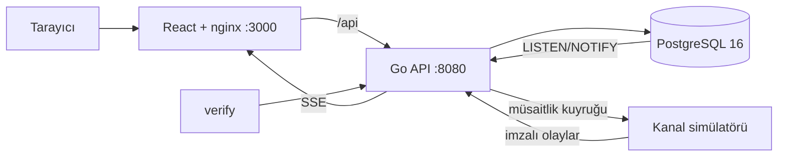

# KonakPro — Otel Yönetim Sistemi

**Geliştirici:** Furkan Gül · DDO Yazılım Ekibi Alım Projesi

KonakPro, 120 odalı bir otelin rezervasyon, oda tahsisi, check-in/out, folyo, fiyatlandırma ve gece denetimi süreçlerini yöneten bir PMS'tir. Odak noktası otelcilikteki üç temel hatayı önlemektir: aynı odanın iki kez satılması, yanlış fiyat ve gece sonu hesap hataları. Bu kuralların tamamı uygulama katmanında değil, mümkün olduğunca veritabanı kısıtlarında korunur.

## Kurulum

Gereksinim: Docker ve Docker Compose.

```bash
git clone <repo-adresi> && cd <repo>
cp .env.example .env
docker compose up --build
```

| Servis | Adres |
|---|---|
| Arayüz | http://localhost:3000 |
| API | http://localhost:8080 |
| OpenAPI | http://localhost:8080/openapi.yaml |
| Metrikler | http://localhost:8080/metrics |

Migrasyon ve seed otomatik çalışır. Boş Docker önbelleğiyle ölçülen hazır olma süresi **55 saniyedir** (sınır: 5 dakika).

### Demo hesapları

Tüm hesapların parolası: `Konak!2026`

| Rol | E-posta |
|---|---|
| Resepsiyon | resepsiyon@konakpro.test |
| Rezervasyon | rezervasyon@konakpro.test |
| Kat Hizmetleri | kathizmeti@konakpro.test |
| Gelir Yönetimi | gelir@konakpro.test |
| Genel Müdür | mudur@konakpro.test |
| Misafir | misafir@konakpro.test |

### Komutlar

| Komut | Görev |
|---|---|
| `make verify` | Demo verisini sıfırlar, tüm özellikleri uçtan uca dener, PASS/FAIL tablosu basar |
| `make reset-demo` | Veriyi ilk seed haline döndürür |
| `make test` | Birim ve entegrasyon testleri, `-race`, kapsama eşiği |
| `make load` | k6 yük testi |
| `make chaos` | Hata enjeksiyonu senaryosu |

Otel günü gerçek saatten bağımsızdır, gece denetimiyle ilerler. Seed'in başlangıç günü `SEED_ANCHOR_DATE` ile belirlenir (varsayılan 1 Kasım 2026). `make verify` gece denetimi çalıştırdığı için bugünkü gelmeyen misafirler `no_show` olur; arayüzü incelemeden önce `make reset-demo` çalıştırın.

## Mimari



| Bileşen | Teknoloji | Gerekçe |
|---|---|---|
| Backend | Go 1.26, chi | Standart `net/http` ile uyumlu, ince yönlendirici |
| Veri erişimi | pgx + sqlc | Kilit ve kısıt detayları SQL'de açık kalır, tip güvenliği korunur |
| Migrasyon | goose | Dosyalar binary'ye gömülü, seed servisi çalıştırır |
| Kimlik | JWT + refresh rotasyonu, argon2id | Çalınan refresh token tekrar kullanılırsa oturum ailesi kapanır |
| Frontend | React 19, TypeScript, Vite, TanStack Query | Çizelge gibi durumlu ekranlar için uygun, sunucu verisi önbelleği hazır. UI kütüphanesi kullanılmadı, paket küçük kaldı |
| Grafikler | Elle yazılmış SVG | Tek ihtiyaç iki grafik türü, kütüphane gereksiz |

### Kod yapısı

```
backend/
  cmd/api          HTTP sunucusu ve kanal kuyruk işçisi
  cmd/simulator    Seed, sıfırlama ve OTA simülatörü
  cmd/verify       make verify aracı
  internal/pricing     Fiyat motoru (saf, veritabanı bağımsız)
  internal/allocation  Oda tahsis çözücüsü (saf, veritabanı bağımsız)
  internal/booking     Stok, rezervasyon, walk, check-in/out
  internal/folio       Folyo işlemleri
  internal/nightaudit  Gece denetimi
  internal/channel     Kanal gelen kutusu ve giden kuyruk
  internal/assign      Çözücü sonucunu veritabanına uygulama
  internal/api         Rotalar, rol tablosu, handler'lar
  internal/db          Migrasyonlar ve sqlc çıktısı
frontend/src           React uygulaması
```

Rotalar tek bir tabloda rolleriyle tanımlıdır (`backend/internal/api/routes.go`). Bir test tablodaki her korumalı ucun oturumsuz istekte 401 döndüğünü ve rol tanımladığını, başka bir test her ucun OpenAPI'de yer aldığını doğrular.

### Zorlu görevler nasıl çözüldü

**Müsaitlik ve overbooking.** Stok `inventory` tablosunda oda tipi ve gece başına tutulur. Satış, tarih sırasıyla `SELECT ... FOR UPDATE` alarak kilitlenir, bu sıra kilitlenmeleri önler. `CHECK (sold <= capacity + overbook_limit)` uygulama hatası olsa bile fazla satışı engeller. Fiziksel oda için `EXCLUDE USING gist (room_id WITH =, stay WITH &&)` kısıtı vardır. Oda sayısını aşan satışlar için walk akışı yalnızca gerçekten fazla satılmış gecelerde çalışır, maliyeti ve anlaşmalı oteli kaydeder.

**Fiyat motoru.** `pricing.Calculate` saf bir fonksiyondur, tüm hesap kuruş ve baz puanla yapılır. Rezervasyon anındaki girdi ve kurallar `price_input` / `price_rules` alanlarına yazılır. Böylece kurallar değişse de aynı fiyat yeniden üretilebilir, `GET /reservations/{id}/price` bunu hash ile doğrular. Uyumsuz kampanya kodları reddedilir. Erken rezervasyonla birleşmeyen bir kampanyada misafir lehine olan seçenek uygulanır.

**Oda tahsisi.** Önce başlangıç tarihine göre sıralı açgözlü yerleştirme yapılır. Sabit oda yoksa bu sıralama sıfır taşımayı garanti eder (aralık grafı renklendirmesi). Yer bulunamazsa bipartite eşleşmedeki artıran yol mantığıyla engelleyen konaklamalar zincirleme başka odaya taşınır, bu da olmazsa en az parçaya bölünür. Son olarak tohumlu yerel arama kat, manzara ve bitişiklik isteklerini iyileştirir.

**Gece denetimi.** Her konaklama ayrı transaction'da işlenir ve `night_audit_items` üzerinde tamamlandı işaretlenir, süreç öldürülse bile kaldığı yerden devam eder. `(reservation_id, business_date, kind)` üzerindeki benzersiz dizin aynı gecenin iki kez yazılmasını veritabanı seviyesinde engeller. `folio_lines` eklemeli-yalnızdır, `balance_kurus` yalnızca tetikleyiciyle değişir. Elle güncelleme de reddedilir.

**Kanal senkronizasyonu.** Her olay rezervasyonun tam durumunu taşır. `(channel_id, event_id)` benzersizliği tekrarları, `last_seq` eski sıralı olayları eler. Bu sayede `modify` olayı `create`'ten önce gelse de sonuç aynıdır. İptal terminaldir, önce gelirse sonraki olaylar yok sayılır. Giden tarafta stok değiştiğinde aynı transaction içinde tetikleyici kuyruğa yazar, işçi `FOR UPDATE SKIP LOCKED` ile alır, üstel geri çekilme ve jitter ile yeniden dener, limit aşılınca ölü kuyruğa atar. Mesaj gönderim anındaki güncel stoğu okuduğu için sıra önemsizdir.

## Ölçümler

Tüm değerler 8 çekirdekli Apple Silicon makinede Docker içinde ölçülmüştür.

### Yük testi (`make load`, 45 sn)

30 sanal kullanıcı müsaitlik, teklif ve liste okurken saniyede 40 rezervasyon denemesi gönderilir.

| Uç | p50 | p95 | p99 | Hata oranı |
|---|---|---|---|---|
| Müsaitlik | 13,61 ms | 24,28 ms | 30,98 ms | %0 |
| Rezervasyon | 30,36 ms | 54,51 ms | 76,08 ms | %0 |
| Tümü (135.546 istek, 3.007 istek/sn) | 9,15 ms | 21,46 ms | 31,31 ms | %0 |

### Kapsama (`make test`)

| Paket | İfade kapsamı |
|---|---|
| pricing | %92,9 |
| allocation | %95,3 |
| booking | %74,4 |
| folio | %78,9 |
| nightaudit | %75,2 |
| channel | %87,4 |
| assign | %77,4 |
| **Alan toplamı** | **%83,5** |

Backend'de 120 test fonksiyonu vardır. %70'in altına düşen paket CI'ı kırar (`scripts/coverage-gate.sh`).

### Oda tahsisi

| Senaryo | Sonuç |
|---|---|
| 120 oda, 400 rezervasyon | 52 ms, 0 taşıma, 276 isteğin 244'ü karşılandı |
| %100 dolu, kilitli odalı 20 senaryo | Toplam 12 taşıma (ilk uygun yöntem 34), en kötü 1,57 sn |
| Canlı sistem, 90 gün ufuk | 130 oda, 1.066 konaklama, 299 ms |

### Dizinler

Veri: 27.018 rezervasyon, 87.688 gece. Tam çıktılar: [`docs/explain-analyze.txt`](docs/explain-analyze.txt).

| Sorgu | Dizin | Dizinli | Dizinsiz |
|---|---|---|---|
| Gelecek 30 gecenin doluluğu | `reservation_nights_date_idx` | 1,06 ms, 55 tampon | 5,58 ms, 814 tampon |
| Geçmiş tarihli giriş araması | `reservations_arrivals_idx` | 0,05 ms, 6 tampon | 2,51 ms, 600 tampon |
| Misafirin rezervasyonları | `reservations_guest_idx` | 0,07 ms, 7 tampon | 1,44 ms, 603 tampon |

```text
Index Only Scan using reservation_nights_date_idx on reservation_nights n (actual rows=1429 loops=1)
  Index Cond: ((stay_date >= '2026-11-01'::date) AND (stay_date < '2026-12-01'::date))
  Heap Fetches: 0
Execution Time: 1.060 ms
```

## Doğrulama Soruları

### 1. En zorlandığın görev hangisiydi? Hangi alternatifleri düşündün, neden eledin?

Oda tahsisi. Sabit oda olmadığında problem kolaydır, sıralı yerleştirme taşımasız sonuç verir. Zorluk, kilitli odalar devreye girince başlar, bu noktada problem NP-zordur.

Değerlendirilen alternatifler:

- **Tam sayılı programlama:** Optimum verir ama Go'da bağımlılık ve süre riski getirir, 10 saniye sınırı için güvence vermez.
- **Yalnızca tavlama benzetimi:** Yazması kolay ama bölünmüş konaklamaları birleştirmekte zayıf kaldı.
- **Tek seviyeli tahliye:** İlk sürüm buydu. Dolu otel senaryosunda 34 taşımayı yalnızca 26'ya indirdi.

Seçilen yöntem artıran yol zinciridir, aynı senaryoda 12 taşıma ve en kötü 1,57 saniye sonuç verdi.

### 2. Çözümünün kırıldığı veya yetersiz kaldığı senaryolar

- **Idempotency penceresi:** Handler transaction'ı işledikten sonra, yanıt anahtara yazılmadan süreç ölürse aynı anahtarla gelen istek 60 saniyelik kilit süresinden sonra yeniden çalışır. Tam çözüm anahtarı iş transaction'ının içine almaktır.
- **Tahsis optimum değildir:** %100 dolu senaryolarda sıfır taşımalı çözüm varken çözücü 12 taşıma bırakıyor. Sabit süreli sezgisel yöntemin bedeli budur.
- **Arızalı oda stoğu düşürmez:** Oda `out_of_order` yapıldığında satılabilir stok kendiliğinden azalmaz, yalnızca çözücü o odayı kullanmaz.
- **Kanal çakışması elle çözülür:** Dolu tarihe gelen OTA rezervasyonu `conflict` olarak işaretlenir, otomatik walk yapılmaz.
- **İptal ve no-show ücreti yok:** İadesiz tarife fiyata yansır ama no-show için ücret yazılmaz.
- **Sınırlar:** Giriş denemesi hız sınırı yoktur, access token süresi dolana kadar (15 dk) geri alınamaz, 3 yıllık geçmiş rezervasyonlarda folyo satırı üretilmez.

### 3. İki dizin ve ölçüm farkı

Üstteki Dizinler tablosunda. `reservation_nights_date_idx` gelecek doluluk sorgusunda sıralı taramayı kaldırır, 5,58 ms'yi 1,06 ms'ye, okunan tamponu 814'ten 55'e düşürür. `INCLUDE (net_kurus, reservation_id)` sayesinde tabloya gidilmez (`Heap Fetches: 0`).

`reservations_arrivals_idx` ilginç bir sonuç verdi: bugünkü gelenler sorgusunda fark yaratmıyor (0,047 ms'ye karşı 0,034 ms), çünkü onaylı kayıtları kısmi dizin zaten kapsıyor. Fark geçmiş tarih aramasında ortaya çıkıyor: 2,51 ms'den 0,05 ms'ye. Dizin bu arama için tutuldu.

### 4. Yapay zekâ kullanımı

Bu projede Claude Code kullanıldı. Kod, testler ve dokümanlar yapay zekâ ile üretildi. Aşağıdaki çıktı doğrulama sırasında reddedildi:

**Önce:** Çözücünün kilitli odalarda iyi çalıştığını kanıtlaması beklenen test, rastgele pin atıyordu.

```go
for i := range stays {
	if stays[i].From <= 2 && rng.Intn(2) == 0 {
		candidates := byType[stays[i].TypeID]
		stays[i].PinRoom = candidates[rng.Intn(len(candidates))].ID
	}
}
```

Sonuç: `çözücü=0 ilk-uygun=0`. Test geçti ama hiçbir şey kanıtlamadı. Doluluk gevşekti, çakışan pinler de taşımaya değil sessizce "atanamadı" sonucuna gidiyordu ve test bunu kontrol etmiyordu.

**Sonra:** Sıfır taşımalı çözümü olduğu bilinen %100 dolu zincirler üretildi, her konaklama kendi zincirindeki odaya kilitlendi ve atanamayan sayısı da sınandı.

```go
st := Stay{ID: id, TypeID: 1, From: day, To: day + length}
if rng.Intn(pinEvery) == 0 {
	st.PinRoom = int64(r)
}
```

Yeni test `çözücü=26 ilk-uygun=34` göstererek algoritmanın yetersiz olduğunu ortaya çıkardı. Bu da artıran yol zincirinin yazılmasına yol açtı ve sonuç 12'ye indi. Geçen ama boş bir test, kalmış bir algoritma hatasını gizliyordu.

Doğrulamada yakalanan diğer iki hata: `crypto.randomUUID` yalnızca HTTPS veya localhost'ta çalıştığı için rezervasyon düğmesi IP adresiyle erişimde çalışmıyordu, ve yeni rezervasyon formunda hook'lar erken `return` sonrasına yazılmıştı.

### 5. Overbooking çözümünün doğruluğunu nasıl kanıtladın?

Üç bağımsız kanıt var. Uçtan uca test API'ye 300 eşzamanlı istek gönderir, 10 odalı ve %10 overbooking tanımlı tipte tam 11 rezervasyon oluşmalıdır:

```bash
make verify
```

```text
T-1        PASS      0.26s  300 eşzamanlı rezervasyon, overbooking ve walk
```

Yarış dedektörlü entegrasyon testi 5 oda + %20 için aynı kontrolü yapar:

```bash
go test -race ./internal/booking -run TestConcurrentBookingNeverExceedsStock
```

`TestDatabaseRejectsOversellEvenWithoutService` ise servisi atlayıp doğrudan SQL ile stok artırmayı dener ve `inventory_not_oversold` kısıtına takıldığını gösterir. Yani uygulama kodu hatalı olsa bile fazla satış oluşmaz.

## Kaos senaryosu

`make chaos` üç bağımlılığı sırayla bozar. Son çıktı: [`docs/chaos-output.txt`](docs/chaos-output.txt), 11 kontrolün 11'i başarılı.

1. Veritabanı durur, API çökmeden 503 döner, veritabanı dönünce toparlanır.
2. Simülatör durur, mesajlar yeniden denenir, dönünce kuyruk boşalır.
3. Gece denetimi ortasında API süreci `os.Exit(137)` ile ölür, yeniden başlayınca kaldığı yerden sürer, çift ücret oluşmaz.

Mimari kararların gerekçeleri [`DECISIONS.md`](DECISIONS.md), test talimatları [`TESTING.md`](TESTING.md) dosyasındadır.
